# Odoo Community Edition - Data Model & Entity Relationships

**Analyzed Version**: Odoo 17.0  
**Analysis Date**: October 14, 2026

This document visualizes the core data model of Odoo CE using Entity Relationship Diagrams.

---

## Table of Contents

1. [Core Entities](#core-entities)
2. [CRM Module](#crm-module)
3. [Sales Module](#sales-module)
4. [Purchase Module](#purchase-module)
5. [Inventory Module](#inventory-module)
6. [Accounting Module](#accounting-module)
7. [HR Module](#hr-module)
8. [Project Module](#project-module)
9. [Cross-Module Integration](#cross-module-integration)

---

## Core Entities

### Base System

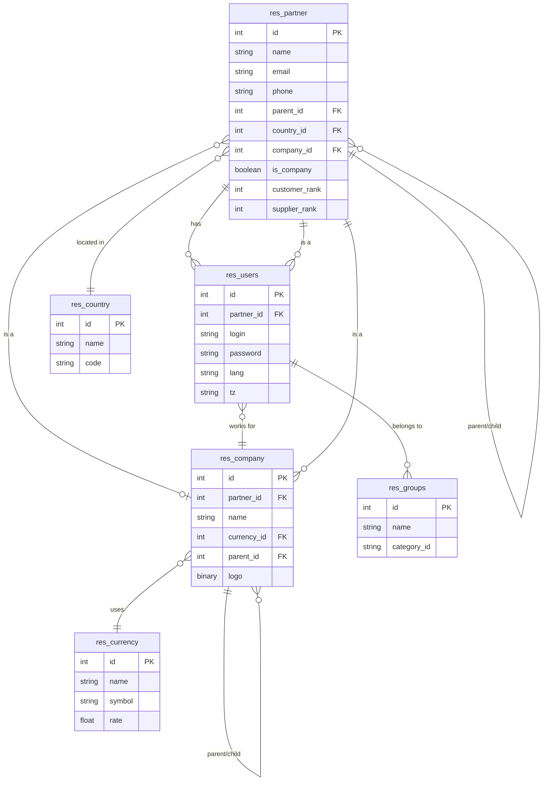

---

## CRM Module

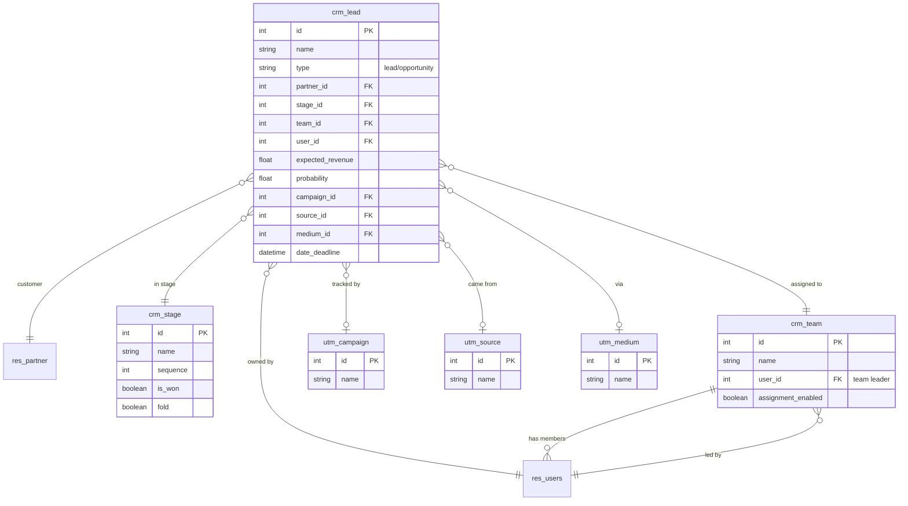

---

## Sales Module

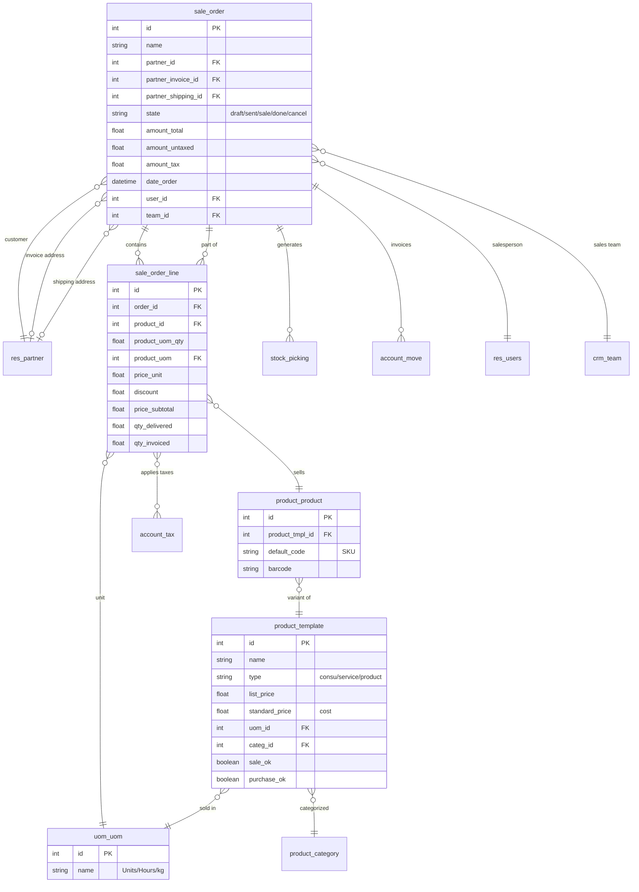

---

## Purchase Module

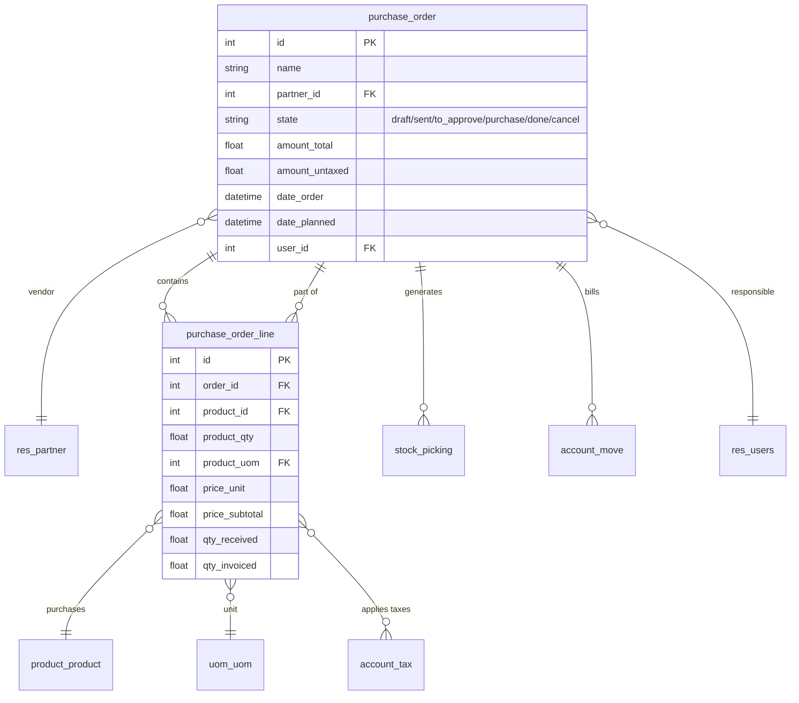

---

## Inventory Module

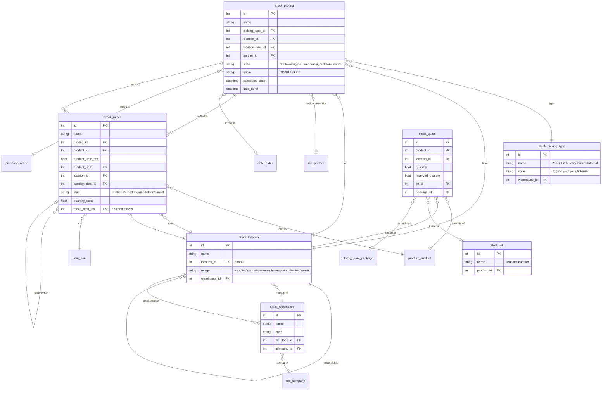

---

## Accounting Module

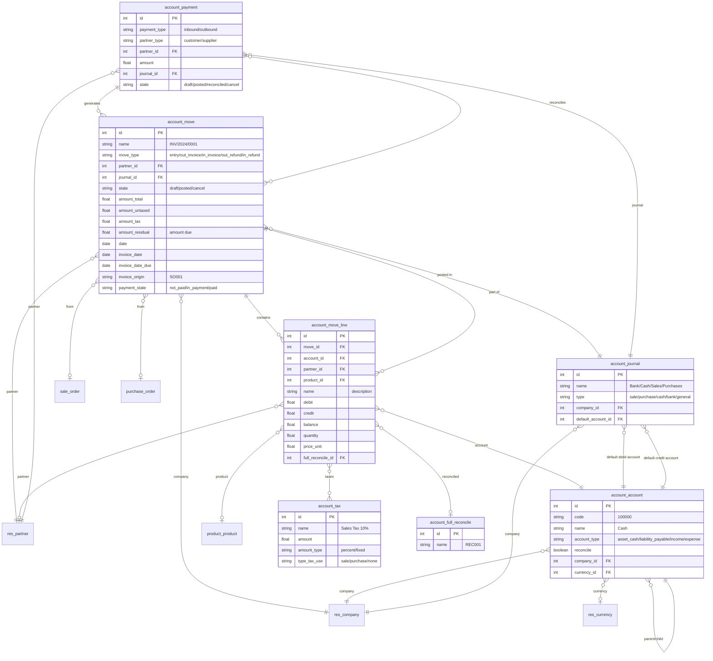

---

## HR Module

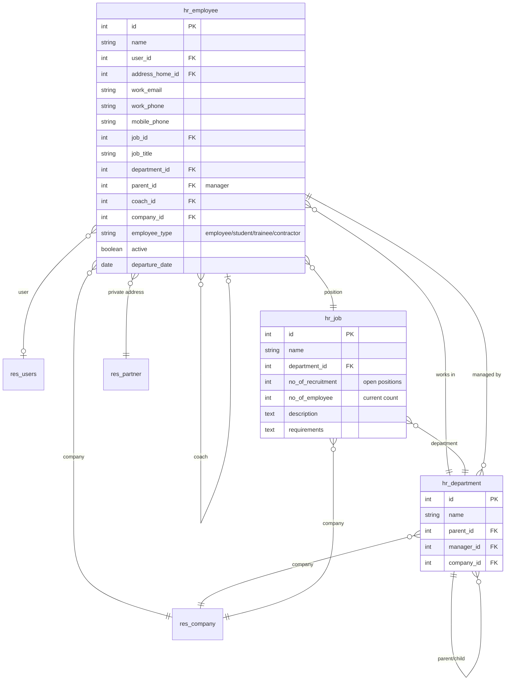

---

## Project Module

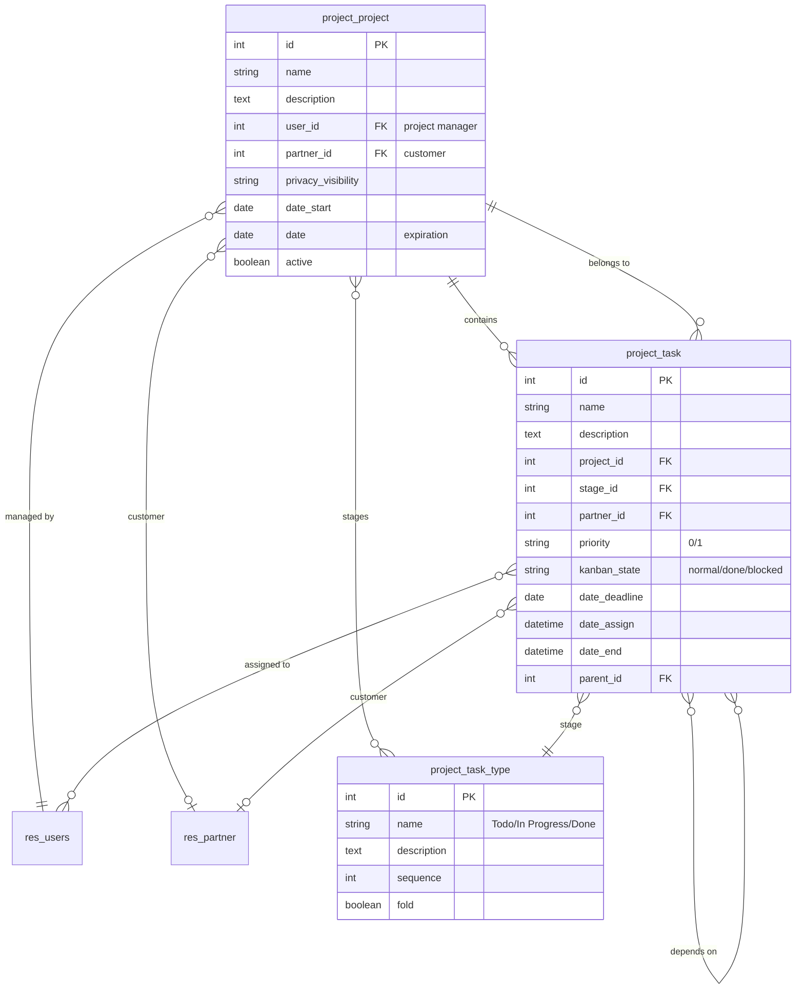

---

## Cross-Module Integration

### Full Sales-to-Cash Flow

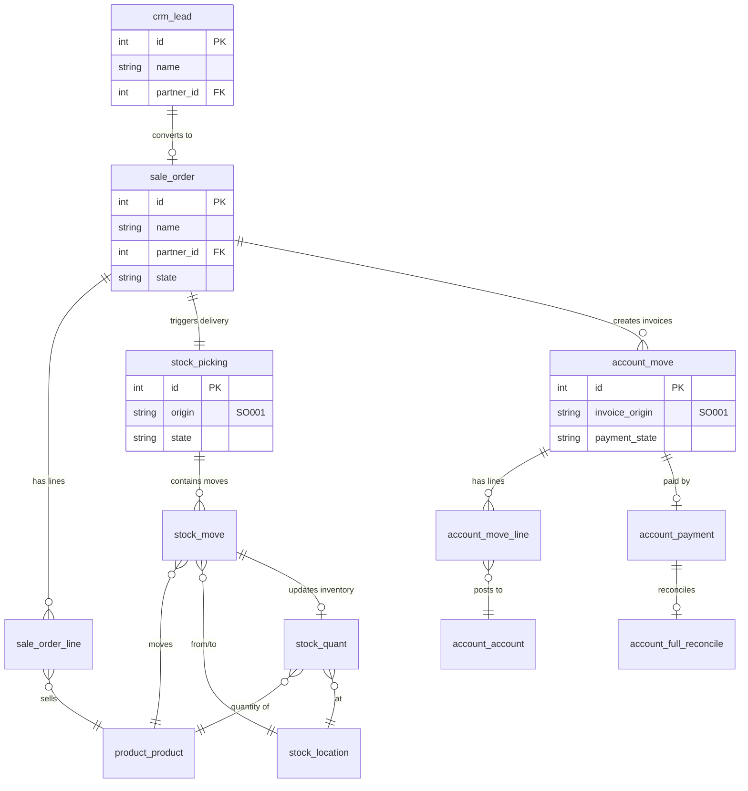

### Full Purchase-to-Pay Flow

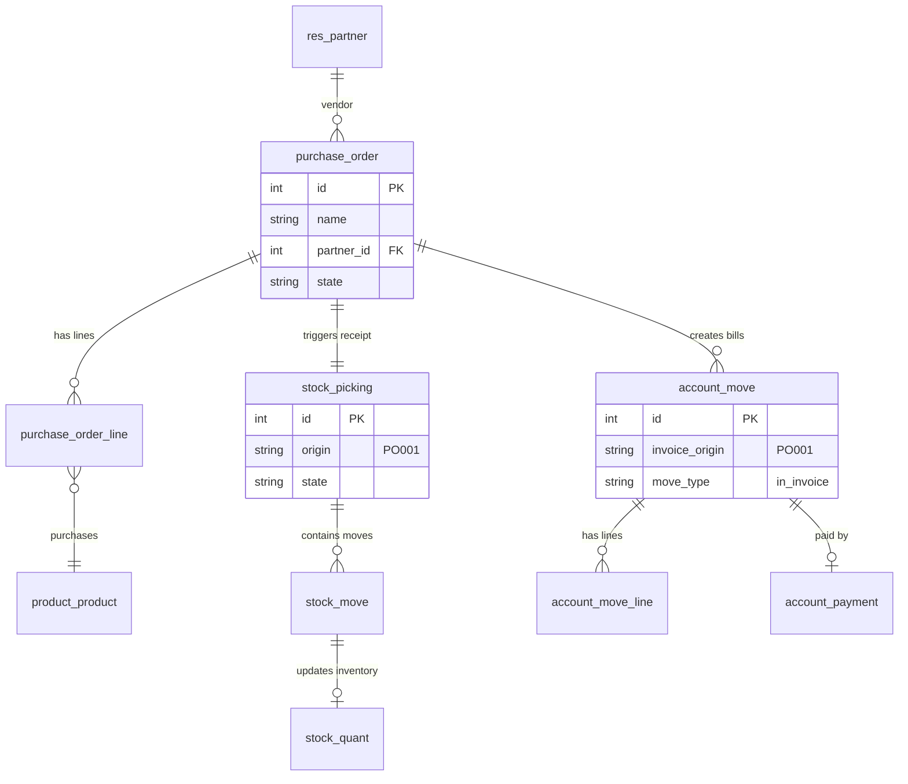

### res.partner as Central Hub

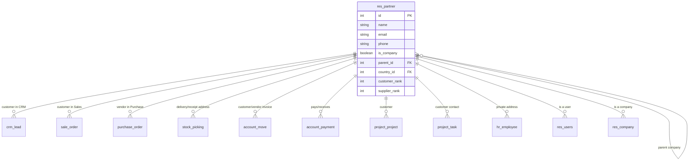

---

## Database Schema Notes

### Table Naming Convention
- Model `res.partner` → Table `res_partner`
- Model `sale.order` → Table `sale_order`
- Underscores replace dots

### Standard Columns (All Models)
```sql
id SERIAL PRIMARY KEY
create_uid INTEGER REFERENCES res_users(id)
create_date TIMESTAMP WITHOUT TIME ZONE
write_uid INTEGER REFERENCES res_users(id)
write_date TIMESTAMP WITHOUT TIME ZONE
```

### Many2many Relationship Tables
Automatically created with naming pattern: `{model1}_{model2}_rel`

Example: `sale_order_line` ↔ `account_tax`
```sql
CREATE TABLE sale_order_line_account_tax_rel (
    sale_order_line_id INTEGER REFERENCES sale_order_line(id) ON DELETE CASCADE,
    account_tax_id INTEGER REFERENCES account_tax(id) ON DELETE CASCADE,
    PRIMARY KEY (sale_order_line_id, account_tax_id)
);
```

### Inheritance Implementation
- **Classical inheritance**: Separate tables, copy fields
- **Extension**: Same table, add columns
- **Delegation (_inherits)**: Separate tables with foreign key

Example: `res.users` inherits from `res.partner` via delegation
```sql
-- res_partner table exists
CREATE TABLE res_users (
    id SERIAL PRIMARY KEY,
    partner_id INTEGER REFERENCES res_partner(id) ON DELETE CASCADE,
    login VARCHAR NOT NULL,
    password VARCHAR,
    -- ... other user-specific fields
);
```

### Indexes
Odoo automatically creates indexes on:
- Primary keys (id)
- Foreign keys (Many2one fields)
- Fields with `index=True`
- Fields marked `required=True` if frequently queried

---

## Summary Statistics

**Total Core Tables**: ~400+ tables across all modules

**Key Relationships**:
- res.partner: Central hub, referenced by ~50+ models
- product.product: Referenced by sales, purchase, stock, accounting
- account.move: Links to sales, purchase, stock (invoice_origin)
- stock.picking: Links to sales, purchase (origin field)

**Cross-Module Foreign Keys**:
- Every business module references res.partner
- Stock links to sales (sale_id) and purchase (purchase_id)
- Accounting links to sales (invoice_origin), purchase, stock
- All modules use res.company for multi-tenancy
- All transactional models use res.users for audit trail (create_uid, write_uid)

---

## Next Steps

See [BUILD_OUR_OWN.md](BUILD_OUR_OWN.md) for recommendations on implementing a similar architecture with modern technologies.
